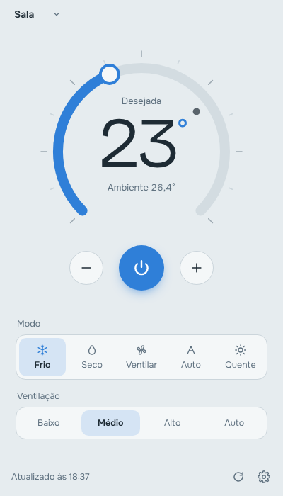
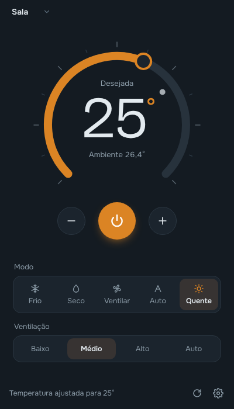

# LG ThinQ Desktop

Controle seu ar-condicionado LG ThinQ pelo computador, em uma única tela.

O LG ThinQ Desktop é um app de desktop (Windows, macOS e Linux) que liga e desliga o ar, ajusta a temperatura, troca o modo e a ventilação. Ele usa a **API oficial da LG (ThinQ Connect)**, a mesma usada pela integração do Home Assistant.

<p>
  
  
</p>

## O que dá para fazer

- Ligar e desligar
- Ajustar a temperatura arrastando o mostrador, com a roda do mouse, pelas setas do teclado ou nos botões − e +
- Ver a temperatura ambiente
- Trocar o modo (frio, seco, ventilar, auto, quente, conforme o seu modelo)
- Trocar a velocidade da ventilação
- Alternar entre aparelhos, se você tiver mais de um

Os modos e velocidades que aparecem vêm do próprio aparelho, então a tela se adapta ao seu modelo.

## Antes de começar

1. O ar-condicionado precisa estar conectado no app **LG ThinQ** do celular. Se ele já funciona lá, está pronto.
2. Gere um **token pessoal (PAT)**:
   - Acesse [connect-pat.lgthinq.com](https://connect-pat.lgthinq.com) e entre com a **mesma conta LG** do app.
   - Clique em **Add New Token**, dê um nome (ex.: `desktop`) e marque as três permissões: ver aparelhos, ver status e controlar aparelhos.
   - Copie o valor do token.

O app pede o token na primeira vez que abre. Ele fica salvo só no seu computador, criptografado pelo sistema (DPAPI no Windows, Keychain no macOS).

> Por que um token, se o app do celular não pede? O app ThinQ é da própria LG e entra com a sua conta usando credenciais internas. O token é a forma oficial que a LG oferece para programas de terceiros acessarem a mesma nuvem em seu nome.

## Instalar

Baixe o instalador `.exe` mais recente na aba [Releases](../../releases). Há também uma versão portátil, que roda sem instalar.

## Rodar a partir do código

Requer Node.js 20 ou mais novo.

```bash
npm install
npm start
```

Para testar a interface sem token nem ar-condicionado, use o modo demonstração:

```bash
npm run demo
```

Outros comandos:

| Comando | O que faz |
| --- | --- |
| `npm run dev` | Abre o app com o DevTools |
| `npm test` | Roda os testes |
| `npm run dist` | Gera o instalador do Windows em `dist/` |

## Publicar uma versão

O workflow `.github/workflows/release.yml` gera o instalador do Windows e publica na aba Releases quando você envia uma tag:

```bash
npm version patch        # ou minor / major
git push --follow-tags
```

## Como funciona

```
Interface (renderer)  ⇄  processo principal (Node)  ⇄  api-aic.lgthinq.com
       tela                  guarda o token                nuvem da LG
```

- O token nunca chega na interface: só o processo principal o usa (`src/main`).
- O ar-condicionado não é controlado pela rede local. Os comandos vão para a nuvem da LG, que repassa ao aparelho, igual ao app do celular. Por isso é preciso internet.
- O estado é atualizado a cada 30 segundos e sempre que a janela volta ao foco. A LG limita o número de chamadas por token, então evite diminuir muito esse intervalo.
- O servidor da API depende do país da conta. Brasil e o resto das Américas usam `api-aic.lgthinq.com`.

```
src/
  main/
    main.js      janela, IPC e ciclo de vida
    thinq.js     cliente da API ThinQ Connect
    ac.js        traduz profile/estado do ar e monta os comandos
    regions.js   país → servidor da API
    store.js     configuração local e token criptografado
    demo.js      aparelho simulado para `npm run demo`
  preload.js     ponte segura entre a tela e o processo principal
  renderer/      a tela (HTML, CSS e JS puros)
test/            testes com node:test
```

## Problemas comuns

| Mensagem | O que fazer |
| --- | --- |
| Token inválido ou expirado | Gere um novo token e salve em Configurações (ícone de engrenagem). |
| O token não tem permissão de controle | Gere outro token marcando "All device control rights". |
| Nenhum ar-condicionado encontrado | Confira se o aparelho aparece no app ThinQ com a mesma conta do token. |
| O aparelho está offline | Verifique se o ar está na tomada e no Wi-Fi (2,4 GHz). |
| Limite de chamadas atingido | Aguarde alguns minutos. |

## Licença

MIT. Fontes sob SIL Open Font License; trechos de referência do SDK `thinqconnect` sob Apache-2.0. Veja [LICENSE](LICENSE).

Este projeto não é afiliado à LG Electronics. LG e ThinQ são marcas da LG Electronics.
